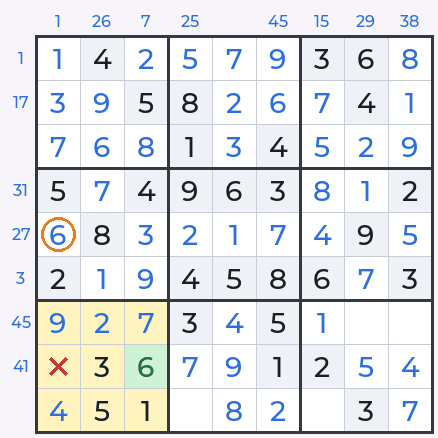

<!-- Written by tools/walkthrough.py x-sums: edit the script, not this page. -->
# X-Sums, step 46: the 6 in box 7

**Step 46 of 51** · [← Step 45](step-45.md) · [All steps](../x-sums.md#the-whole-puzzle-step-by-step) · [Step 47 →](step-47.md)

Box 7 needs a 6. r8c1: column 1 has one (r5c1). Only **r8c3** is left: **r8c3 = 6**.

**Step 46 of 51** · [← Step 45](step-45.md) · [All steps](../x-sums.md#the-whole-puzzle-step-by-step) · [Step 47 →](step-47.md)
