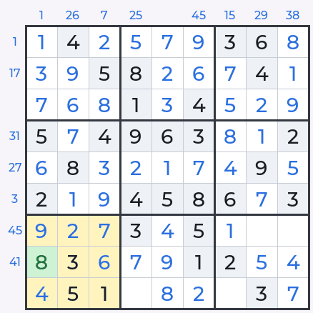

<!-- Written by tools/walkthrough.py x-sums: edit the script, not this page. -->
# X-Sums, step 47: the 8 in box 7

**Step 47 of 51** · [← Step 46](step-46.md) · [All steps](../x-sums.md#the-whole-puzzle-step-by-step) · [Step 48 →](step-48.md)

Box 7 needs an 8, and r8c1 is its last empty cell: **r8c1 = 8**.

**Step 47 of 51** · [← Step 46](step-46.md) · [All steps](../x-sums.md#the-whole-puzzle-step-by-step) · [Step 48 →](step-48.md)
