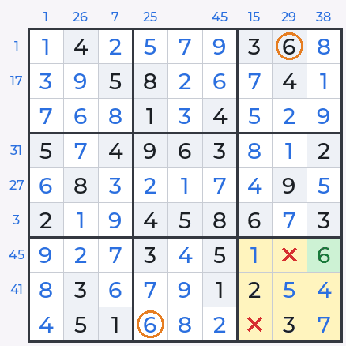

<!-- Written by tools/walkthrough.py x-sums: edit the script, not this page. -->
# X-Sums, step 49: the 6 in box 9

**Step 49 of 51** · [← Step 48](step-48.md) · [All steps](../x-sums.md#the-whole-puzzle-step-by-step) · [Step 50 →](step-50.md)

Box 9 needs a 6. r7c8: column 8 has one (r1c8). r9c7: row 9 has one (r9c4). Only **r7c9** is left: **r7c9 = 6**.

**Step 49 of 51** · [← Step 48](step-48.md) · [All steps](../x-sums.md#the-whole-puzzle-step-by-step) · [Step 50 →](step-50.md)
