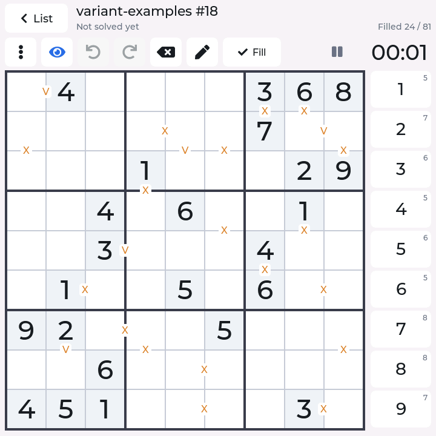

# XV

[← All variants](README.md) · [Puzzles](../features-puzzles.md) · [How to play](../how-to-play.md)



## The rules

[Classic](classic.md) rules, and marks on the lines between side-by-side cells:

- an **X**: the two digits **add up to 10** (the Roman numeral X);
- a **V**: they **add up to 5** (V).

**Every mark is shown**, so where there's **no mark**, the two digits add up to neither 5 nor 10.

## On the board

- The X and V are small orange letters on the grid lines.
- Two digits that break a mark, or a missing mark, turn red.
- The grader and hints narrow each cell by its neighbours across the marks: "The X and V marks around ... (and where there are none) leave it only ...".
- **Puzzles → ⋮ → New puzzle → XV**.

## How to solve it

- **V** pairs are few: 1 + 4 and 2 + 3. A cell on a V is 1 to 4.
- **X** pairs: 1 + 9, 2 + 8, 3 + 7, 4 + 6. A cell on an X is never 5: its partner would have to be a 5 too, in the same row or column.
- **A mark next to a digit** fixes the cell: an X next to a 6 means 4; a V next to a 2 means 3.
- **No mark next to a digit** rules out its partners: next to a 2 with no mark, the cell isn't 3 or 8.

## Worked example

**variant-examples #18**, XV Easy (see [Classic](classic.md#worked-example) for how to import the examples; cells are written r*row*c*column*). The marks are in the screenshot.

```
. 4 . | . . . | 3 6 8
. . . | . . . | 7 . .
. . . | 1 . . | . 2 9
------+-------+------
. . 4 | . 6 . | . 1 .
. . 3 | . . . | 4 . .
. 1 . | . 5 . | 6 . .
------+-------+------
9 2 . | . . 5 | . . .
. . 6 | . . . | . . .
4 5 1 | . . . | . 3 .
```

**Step 1: r2c8, under an X.** There's an **X** between r1c8 (a 6) and r2c8: together they make 10, so **r2c8 = 4**. (The Classic rules alone would leave it 4 or 5.)

**Step 2: r7c3, with no mark to the 2 beside it.** Row 7 has 9, 2 and 5; column 3 has 4, 3, 6 and 1; box 7 has 9, 2, 6, 4, 5 and 1. That leaves 7 and 8. Its left neighbour r7c2 is a 2 with **no mark** between them, so they don't add up to 10: r7c3 isn't 8. **r7c3 = 7**.

**Step 3: r8c2, under a V.** There's a **V** between r7c2 (a 2) and r8c2: together they make 5, so **r8c2 = 3**.

Check the neighbours that have no mark: r8c2 = 3 next to the 6 on its right (9: fine) and the 5 below (8: fine).
