# XV

[← All variants](README.md) · [Puzzles](../features-puzzles.md) · [How to play](../how-to-play.md)

## The rules

[Classic](classic.md) rules, and marks on the lines between side-by-side cells:

- an **X**: the two digits **add up to 10** (the Roman numeral X);
- a **V**: they **add up to 5** (V).

**Every mark is shown**, so where there's **no mark**, the two digits add up to neither 5 nor 10.

## On the board

- The X and V are small orange letters on the grid lines.
- Two digits that break a mark, or a missing mark, turn red.
- The grader and hints narrow each cell by its neighbours across the marks: "The X and V marks around ... (and where there are none) leave it only ...".
- **Puzzles → ⋮ → New puzzle → XV**.

## How to solve it

- **V** pairs are few: 1 + 4 and 2 + 3. A cell on a V is 1 to 4.
- **X** pairs: 1 + 9, 2 + 8, 3 + 7, 4 + 6. A cell on an X is never 5: its partner would have to be a 5 too, in the same row or column.
- **A mark next to a digit** fixes the cell: an X next to a 6 means 4; a V next to a 2 means 3.
- **No mark next to a digit** rules out its partners: next to a 2 with no mark, the cell isn't 3 or 8.

## Worked example

**variant-examples #18**, XV Easy (see [Classic](classic.md#worked-example-the-whole-puzzle) for how to import the examples; cells are written r*row*c*column*). The marks are in the screenshot.

**Step 1: r2c8, under an X.** There's an **X** between r1c8 (a 6) and r2c8: together they make 10, so **r2c8 = 4**. (The Classic rules alone would leave it 4 or 5.)

**Step 2: r7c3, with no mark to the 2 beside it.** Row 7 has 9, 2 and 5; column 3 has 4, 3, 6 and 1; box 7 has 9, 2, 6, 4, 5 and 1. That leaves 7 and 8. Its left neighbour r7c2 is a 2 with **no mark** between them, so they don't add up to 10: r7c3 isn't 8. **r7c3 = 7**.

**Step 3: r8c2, under a V.** There's a **V** between r7c2 (a 2) and r8c2: together they make 5, so **r8c2 = 3**.

Check the neighbours that have no mark: r8c2 = 3 next to the 6 on its right (9: fine) and the 5 below (8: fine).

## The whole puzzle, step by step

<!-- walkthrough -->
<!-- Written by tools/walkthrough.py xv: edit the script, not this part. -->

The whole puzzle, from the start to the last cell: 57 steps, each one a single (one place left for a digit, or one digit left for a cell), taken in the order a box's single comes first, so not quite the order of the worked example above. In each picture, the unit the step looks at is tinted yellow (for a cell with one digit left: its row, column and box), the new digit is on green, the digits that rule cells out have an **orange ring**, and the empty cells they rule out a **red cross**. Givens are on grey, digits from earlier steps in blue.

#### Step 1: the 1 in box 3

Box 3 needs a 1. r2c8: column 8 has one (r4c8). r3c7: row 3 has one (r3c4). Only **r2c9** is left: **r2c9 = 1**.

#### Step 2: the 1 in box 1

Box 1 needs a 1. r1c3: column 3 has one (r9c3). r2c1, r2c2 and r2c3: row 2 has one (r2c9). r3c1, r3c2 and r3c3: row 3 has one (r3c4). Only **r1c1** is left: **r1c1 = 1**.

#### Step 3: the 4 in box 3

Box 3 needs a 4. r3c7: column 7 has one (r5c7). Only **r2c8** is left: **r2c8 = 4**.

#### Step 4: the 4 in box 2

Box 2 needs a 4. r1c4, r1c5 and r1c6: row 1 has one (r1c2). r2c4, r2c5 and r2c6: row 2 has one (r2c8). r3c5: there's no mark between it and the 1 in r3c4: it isn't 4 or 9. Only **r3c6** is left: **r3c6 = 4**.

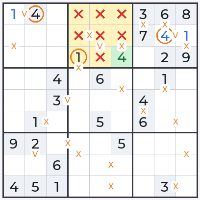

#### Step 5: the 5 in box 3

Box 3 needs a 5, and r3c7 is its last empty cell: **r3c7 = 5**.

#### Step 6: the 1 in box 5

Box 5 needs a 1. r4c4 and r4c6: row 4 has one (r4c8). r5c4: column 4 has one (r3c4). r6c4 and r6c6: row 6 has one (r6c2). r5c6: there's no mark between it and the 4 in r5c7: it isn't 1 or 6. Only **r5c5** is left: **r5c5 = 1**.

#### Step 7: the 4 in box 5

Box 5 needs a 4. r4c4 and r4c6: row 4 has one (r4c3). r5c4 and r5c6: row 5 has one (r5c7). r6c6: column 6 has one (r3c6). Only **r6c4** is left: **r6c4 = 4**.

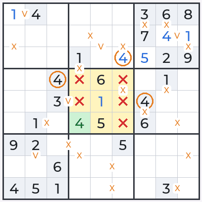

#### Step 8: the 8 in box 7

Box 7 needs an 8. r7c3: there's no mark between it and the 2 in r7c2: it isn't 3 or 8. r8c2: a V joins it to the 2 in r7c2: it's 3. Only **r8c1** is left: **r8c1 = 8**.

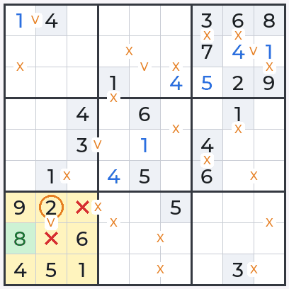

#### Step 9: the 3 in box 7

Box 7 needs a 3. r7c3: column 3 has one (r5c3). Only **r8c2** is left: **r8c2 = 3**.

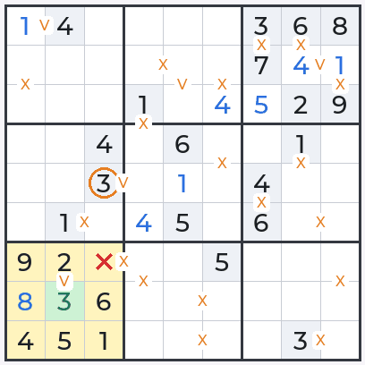

#### Step 10: the 7 in box 7

Box 7 needs a 7, and r7c3 is its last empty cell: **r7c3 = 7**.

#### Step 11: the 1 in box 8

Box 8 needs a 1. r7c4 and r8c4: column 4 has one (r3c4). r7c5 and r8c5: column 5 has one (r5c5). r9c4, r9c5 and r9c6: row 9 has one (r9c3). Only **r8c6** is left: **r8c6 = 1**.

#### Step 12: the 4 in box 8

Box 8 needs a 4. r7c4 and r8c4: column 4 has one (r6c4). r9c4, r9c5 and r9c6: row 9 has one (r9c1). r8c5: an X joins it to the 1 in r8c6: it's 9. Only **r7c5** is left: **r7c5 = 4**.

#### Step 13: the 3 in box 8

Box 8 needs a 3. r8c4 and r8c5: row 8 has one (r8c2). r9c4, r9c5 and r9c6: row 9 has one (r9c8). Only **r7c4** is left: **r7c4 = 3**.

#### Step 14: the 1 in box 9

Box 9 needs a 1. r7c8: column 8 has one (r4c8). r7c9: column 9 has one (r2c9). r8c7, r8c8 and r8c9: row 8 has one (r8c6). r9c7 and r9c9: row 9 has one (r9c3). Only **r7c7** is left: **r7c7 = 1**.

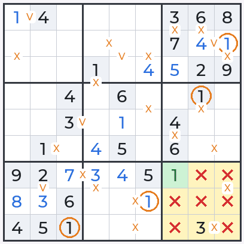

#### Step 15: the 4 in box 9

Box 9 needs a 4. r7c8 and r7c9: row 7 has one (r7c5). r8c7: column 7 has one (r5c7). r8c8: column 8 has one (r2c8). r9c7 and r9c9: row 9 has one (r9c1). Only **r8c9** is left: **r8c9 = 4**.

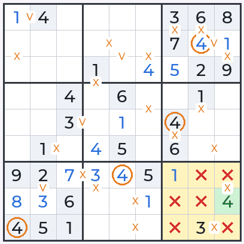

#### Step 16: the 2 in box 9

Box 9 needs a 2. r7c8 and r7c9: row 7 has one (r7c2). r8c8: column 8 has one (r3c8). r9c7: there's no mark between it and the 3 in r9c8: it isn't 2 or 7. r9c9: an X joins it to the 3 in r9c8: it's 7. Only **r8c7** is left: **r8c7 = 2**.

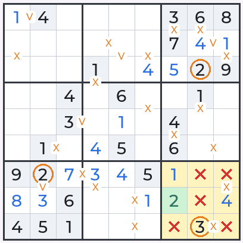

#### Step 17: the 5 in box 9

Box 9 needs a 5. r7c8 and r7c9: row 7 has one (r7c6). r9c7 and r9c9: row 9 has one (r9c2). Only **r8c8** is left: **r8c8 = 5**.

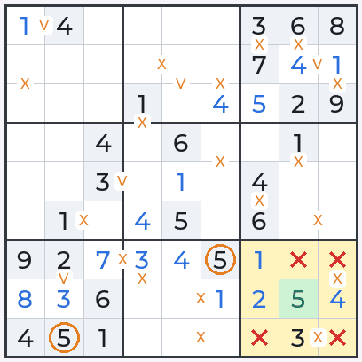

#### Step 18: the 6 in box 9

Box 9 needs a 6. r7c8: column 8 has one (r1c8). r9c7: column 7 has one (r6c7). r9c9: an X joins it to the 3 in r9c8: it's 7. Only **r7c9** is left: **r7c9 = 6**.

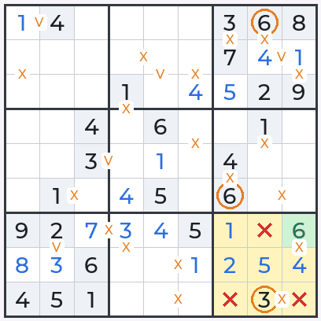

#### Step 19: the 7 in box 9

Box 9 needs a 7. r7c8: row 7 has one (r7c3). r9c7: column 7 has one (r2c7). Only **r9c9** is left: **r9c9 = 7**.

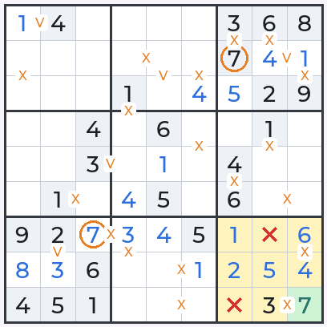

#### Step 20: the 7 in box 6

Box 6 needs a 7. r4c7: column 7 has one (r2c7). r4c9, r5c9 and r6c9: column 9 has one (r9c9). r5c8: an X joins it to the 1 in r4c8: it's 9. Only **r6c8** is left: **r6c8 = 7**.

#### Step 21: the 8 in box 6

Box 6 needs an 8. r4c9, r5c9 and r6c9: column 9 has one (r1c9). r5c8: an X joins it to the 1 in r4c8: it's 9. Only **r4c7** is left: **r4c7 = 8**.

#### Step 22: the 8 in box 4

Box 4 needs an 8. r4c1 and r4c2: row 4 has one (r4c7). r5c1 and r6c1: column 1 has one (r8c1). r6c3: an X joins it to the 1 in r6c2: it's 9. Only **r5c2** is left: **r5c2 = 8**.

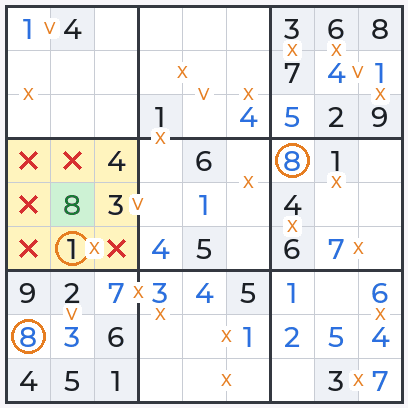

#### Step 23: the 6 in box 4

Box 4 needs a 6. r4c1 and r4c2: row 4 has one (r4c5). r6c1 and r6c3: row 6 has one (r6c7). Only **r5c1** is left: **r5c1 = 6**.

#### Step 24: the 6 in box 1

Box 1 needs a 6. r1c3: row 1 has one (r1c8). r2c1 and r3c1: column 1 has one (r5c1). r2c3 and r3c3: column 3 has one (r8c3). r2c2: there's no mark between it and the 4 in r1c2: it isn't 1 or 6. Only **r3c2** is left: **r3c2 = 6**.

#### Step 25: the 7 in box 1

Box 1 needs a 7. r1c3 and r3c3: column 3 has one (r7c3). r2c1, r2c2 and r2c3: row 2 has one (r2c7). Only **r3c1** is left: **r3c1 = 7**.

#### Step 26: the 3 in box 1

Box 1 needs a 3. r1c3: row 1 has one (r1c7). r2c2: column 2 has one (r8c2). r2c3 and r3c3: column 3 has one (r5c3). Only **r2c1** is left: **r2c1 = 3**.

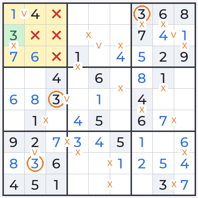

#### Step 27: the 3 in box 2

Box 2 needs a 3. r1c4, r1c5 and r1c6: row 1 has one (r1c7). r2c4, r2c5 and r2c6: row 2 has one (r2c1). Only **r3c5** is left: **r3c5 = 3**.

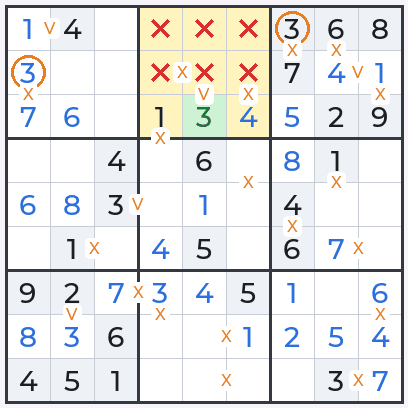

#### Step 28: the 8 in box 2

Box 2 needs an 8. r1c4, r1c5 and r1c6: row 1 has one (r1c9). r2c5: a V joins it to the 3 in r3c5: it's 2. r2c6: an X joins it to the 4 in r3c6: it's 6. Only **r2c4** is left: **r2c4 = 8**.

#### Step 29: the 2 in box 1

Box 1 needs a 2. r2c2: column 2 has one (r7c2). r3c3: row 3 has one (r3c8). r2c3: there's no mark between it and the 8 in r2c4: it isn't 2. Only **r1c3** is left: **r1c3 = 2**.

#### Step 30: the 5 in box 1

Box 1 needs a 5. r2c2: column 2 has one (r9c2). r3c3: row 3 has one (r3c7). Only **r2c3** is left: **r2c3 = 5**.

#### Step 31: the 8 in box 1

Box 1 needs an 8. r2c2: row 2 has one (r2c4). Only **r3c3** is left: **r3c3 = 8**.

#### Step 32: the 9 in box 1

Box 1 needs a 9, and r2c2 is its last empty cell: **r2c2 = 9**.

#### Step 33: the 2 in box 2

Box 2 needs a 2. r1c4, r1c5 and r1c6: row 1 has one (r1c3). r2c6: an X joins it to the 4 in r3c6: it's 6. Only **r2c5** is left: **r2c5 = 2**.

#### Step 34: the 5 in box 2

Box 2 needs a 5. r1c5: column 5 has one (r6c5). r1c6: column 6 has one (r7c6). r2c6: row 2 has one (r2c3). Only **r1c4** is left: **r1c4 = 5**.

#### Step 35: the 6 in box 2

Box 2 needs a 6. r1c5 and r1c6: row 1 has one (r1c8). Only **r2c6** is left: **r2c6 = 6**.

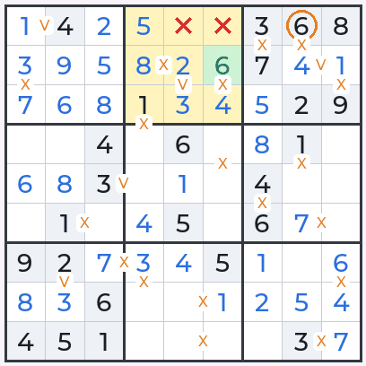

#### Step 36: the 7 in box 2

Box 2 needs a 7. r1c6: there's no mark between it and the 3 in r1c7: it isn't 2 or 7. Only **r1c5** is left: **r1c5 = 7**.

#### Step 37: the 9 in box 2

Box 2 needs a 9, and r1c6 is its last empty cell: **r1c6 = 9**.

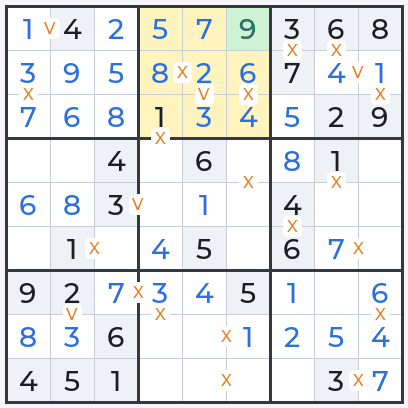

#### Step 38: the 5 in box 4

Box 4 needs a 5. r4c2: column 2 has one (r9c2). r6c1 and r6c3: row 6 has one (r6c5). Only **r4c1** is left: **r4c1 = 5**.

#### Step 39: the 2 in box 4

Box 4 needs a 2. r4c2: column 2 has one (r7c2). r6c3: column 3 has one (r1c3). Only **r6c1** is left: **r6c1 = 2**.

#### Step 40: the 7 in box 4

Box 4 needs a 7. r6c3: row 6 has one (r6c8). Only **r4c2** is left: **r4c2 = 7**.

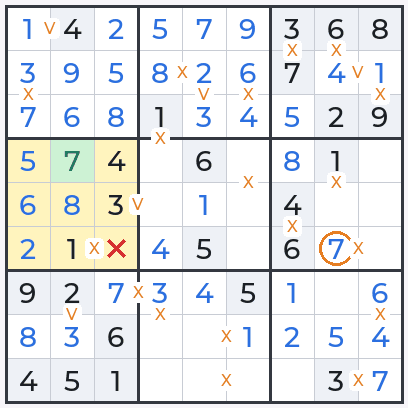

#### Step 41: the 9 in box 4

Box 4 needs a 9, and r6c3 is its last empty cell: **r6c3 = 9**.

#### Step 42: the 7 in box 5

Box 5 needs a 7. r4c4 and r4c6: row 4 has one (r4c2). r6c6: row 6 has one (r6c8). r5c4: a V joins it to the 3 in r5c3: it's 2. Only **r5c6** is left: **r5c6 = 7**.

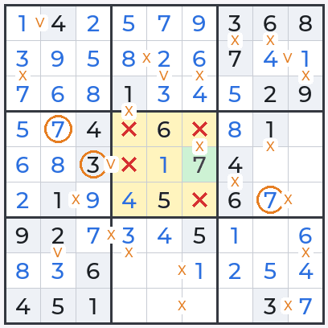

#### Step 43: the 2 in box 5

Box 5 needs a 2. r6c6: row 6 has one (r6c1). r4c4: an X joins it to the 1 in r3c4: it's 9. r4c6: there's no mark between it and the 8 in r4c7: it isn't 2. Only **r5c4** is left: **r5c4 = 2**.

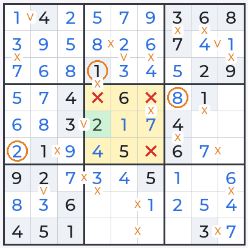

#### Step 44: the 3 in box 5

Box 5 needs a 3. r4c4: column 4 has one (r7c4). r6c6: there's no mark between it and the 7 in r5c6: it isn't 3. Only **r4c6** is left: **r4c6 = 3**.

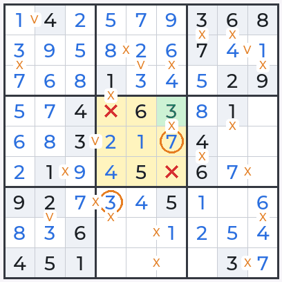

#### Step 45: the 8 in box 5

Box 5 needs an 8. r4c4: row 4 has one (r4c7). Only **r6c6** is left: **r6c6 = 8**.

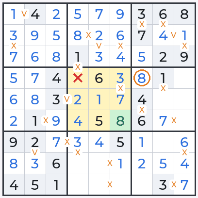

#### Step 46: the 9 in box 5

Box 5 needs a 9, and r4c4 is its last empty cell: **r4c4 = 9**.

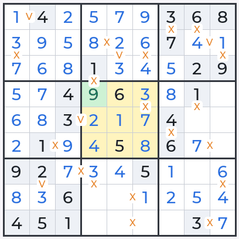

#### Step 47: the 2 in box 6

Box 6 needs a 2. r5c8 and r5c9: row 5 has one (r5c4). r6c9: row 6 has one (r6c1). Only **r4c9** is left: **r4c9 = 2**.

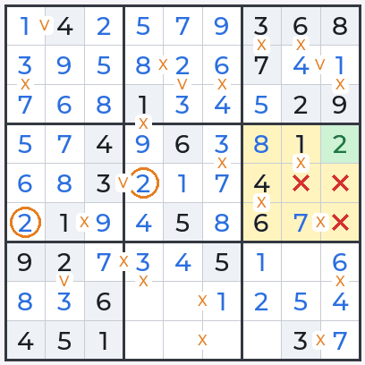

#### Step 48: the 3 in box 6

Box 6 needs a 3. r5c8 and r5c9: row 5 has one (r5c3). Only **r6c9** is left: **r6c9 = 3**.

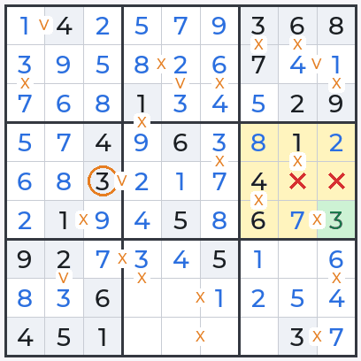

#### Step 49: the 5 in box 6

Box 6 needs a 5. r5c8: column 8 has one (r8c8). Only **r5c9** is left: **r5c9 = 5**.

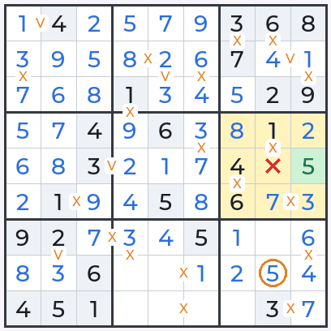

#### Step 50: the 9 in box 6

Box 6 needs a 9, and r5c8 is its last empty cell: **r5c8 = 9**.

#### Step 51: the 2 in box 8

Box 8 needs a 2. r8c4 and r8c5: row 8 has one (r8c7). r9c4: column 4 has one (r5c4). r9c5: column 5 has one (r2c5). Only **r9c6** is left: **r9c6 = 2**.

#### Step 52: the 6 in box 8

Box 8 needs a 6. r8c4 and r8c5: row 8 has one (r8c3). r9c5: column 5 has one (r4c5). Only **r9c4** is left: **r9c4 = 6**.

#### Step 53: the 7 in box 8

Box 8 needs a 7. r8c5: column 5 has one (r1c5). r9c5: row 9 has one (r9c9). Only **r8c4** is left: **r8c4 = 7**.

#### Step 54: the 8 in box 8

Box 8 needs an 8. r8c5: row 8 has one (r8c1). Only **r9c5** is left: **r9c5 = 8**.

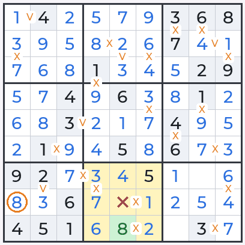

#### Step 55: the 9 in box 8

Box 8 needs a 9, and r8c5 is its last empty cell: **r8c5 = 9**.

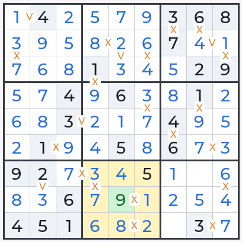

#### Step 56: the 8 in box 9

Box 9 needs an 8. r9c7: row 9 has one (r9c5). Only **r7c8** is left: **r7c8 = 8**.

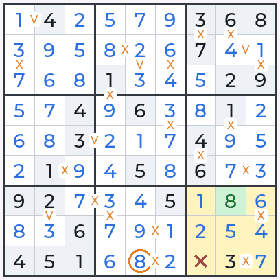

#### Step 57: the 9 in box 9

Box 9 needs a 9, and r9c7 is its last empty cell: **r9c7 = 9**.

Solved.

<!-- /walkthrough -->
