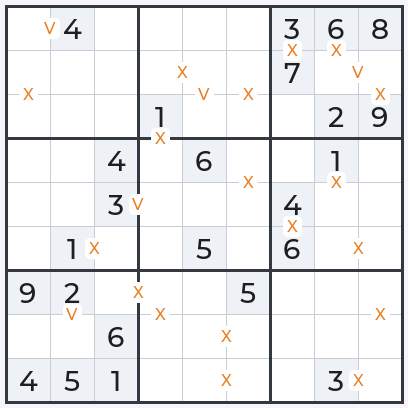

# XV

[← All variants](README.md) · [Puzzles](../features-puzzles.md) · [How to play](../how-to-play.md)

## The rules

[Classic](classic.md) rules, and marks on the lines between side-by-side cells:

- an **X**: the two digits **add up to 10** (the Roman numeral X);
- a **V**: they **add up to 5** (V).

**Every mark is shown**, so where there's **no mark**, the two digits add up to neither 5 nor 10.

## On the board

- The X and V are small orange letters on the grid lines.
- Two digits that break a mark, or a missing mark, turn red.
- The grader and hints narrow each cell by its neighbours across the marks: "The X and V marks around ... (and where there are none) leave it only ...".
- **Puzzles → ⋮ → New puzzle → XV**.

## How to solve it

- **V** pairs are few: 1 + 4 and 2 + 3. A cell on a V is 1 to 4.
- **X** pairs: 1 + 9, 2 + 8, 3 + 7, 4 + 6. A cell on an X is never 5: its partner would have to be a 5 too, in the same row or column.
- **A mark next to a digit** fixes the cell: an X next to a 6 means 4; a V next to a 2 means 3.
- **No mark next to a digit** rules out its partners: next to a 2 with no mark, the cell isn't 3 or 8.

## Worked example

**variant-examples #18**, XV Easy (see [Classic](classic.md#worked-example-the-whole-puzzle) for how to import the examples; cells are written r*row*c*column*). The marks are in the screenshot.

**Step 1: r2c8, under an X.** There's an **X** between r1c8 (a 6) and r2c8: together they make 10, so **r2c8 = 4**. (The Classic rules alone would leave it 4 or 5.)

**Step 2: r7c3, with no mark to the 2 beside it.** Row 7 has 9, 2 and 5; column 3 has 4, 3, 6 and 1; box 7 has 9, 2, 6, 4, 5 and 1. That leaves 7 and 8. Its left neighbour r7c2 is a 2 with **no mark** between them, so they don't add up to 10: r7c3 isn't 8. **r7c3 = 7**.

**Step 3: r8c2, under a V.** There's a **V** between r7c2 (a 2) and r8c2: together they make 5, so **r8c2 = 3**.

Check the neighbours that have no mark: r8c2 = 3 next to the 6 on its right (9: fine) and the 5 below (8: fine).

## The whole puzzle, step by step

<!-- walkthrough -->
<!-- Written by tools/walkthrough.py xv: edit the script, not this part. -->

The whole puzzle, from the start to the last cell: 57 steps, each one a single (one place left for a digit, or one digit left for a cell), taken in the order a box's single comes first, so not quite the order of the worked example above. Each step has a page of its own, with **Previous** and **Next**: pick one from the list below. In each picture, the unit the step looks at is tinted yellow (for a cell with one digit left: its row, column and box), the new digit is on green, the digits that rule cells out have an **orange ring**, and the empty cells they rule out a **red cross**. Givens are on grey, digits from earlier steps in blue.

1. [the 1 in box 3](xv/step-01.md)
2. [the 1 in box 1](xv/step-02.md)
3. [the 4 in box 3](xv/step-03.md)
4. [the 4 in box 2](xv/step-04.md)
5. [the 5 in box 3](xv/step-05.md)
6. [the 1 in box 5](xv/step-06.md)
7. [the 4 in box 5](xv/step-07.md)
8. [the 8 in box 7](xv/step-08.md)
9. [the 3 in box 7](xv/step-09.md)
10. [the 7 in box 7](xv/step-10.md)
11. [the 1 in box 8](xv/step-11.md)
12. [the 4 in box 8](xv/step-12.md)
13. [the 3 in box 8](xv/step-13.md)
14. [the 1 in box 9](xv/step-14.md)
15. [the 4 in box 9](xv/step-15.md)
16. [the 2 in box 9](xv/step-16.md)
17. [the 5 in box 9](xv/step-17.md)
18. [the 6 in box 9](xv/step-18.md)
19. [the 7 in box 9](xv/step-19.md)
20. [the 7 in box 6](xv/step-20.md)
21. [the 8 in box 6](xv/step-21.md)
22. [the 8 in box 4](xv/step-22.md)
23. [the 6 in box 4](xv/step-23.md)
24. [the 6 in box 1](xv/step-24.md)
25. [the 7 in box 1](xv/step-25.md)
26. [the 3 in box 1](xv/step-26.md)
27. [the 3 in box 2](xv/step-27.md)
28. [the 8 in box 2](xv/step-28.md)
29. [the 2 in box 1](xv/step-29.md)
30. [the 5 in box 1](xv/step-30.md)
31. [the 8 in box 1](xv/step-31.md)
32. [the 9 in box 1](xv/step-32.md)
33. [the 2 in box 2](xv/step-33.md)
34. [the 5 in box 2](xv/step-34.md)
35. [the 6 in box 2](xv/step-35.md)
36. [the 7 in box 2](xv/step-36.md)
37. [the 9 in box 2](xv/step-37.md)
38. [the 5 in box 4](xv/step-38.md)
39. [the 2 in box 4](xv/step-39.md)
40. [the 7 in box 4](xv/step-40.md)
41. [the 9 in box 4](xv/step-41.md)
42. [the 7 in box 5](xv/step-42.md)
43. [the 2 in box 5](xv/step-43.md)
44. [the 3 in box 5](xv/step-44.md)
45. [the 8 in box 5](xv/step-45.md)
46. [the 9 in box 5](xv/step-46.md)
47. [the 2 in box 6](xv/step-47.md)
48. [the 3 in box 6](xv/step-48.md)
49. [the 5 in box 6](xv/step-49.md)
50. [the 9 in box 6](xv/step-50.md)
51. [the 2 in box 8](xv/step-51.md)
52. [the 6 in box 8](xv/step-52.md)
53. [the 7 in box 8](xv/step-53.md)
54. [the 8 in box 8](xv/step-54.md)
55. [the 9 in box 8](xv/step-55.md)
56. [the 8 in box 9](xv/step-56.md)
57. [the 9 in box 9](xv/step-57.md)

Solved.

<!-- /walkthrough -->
