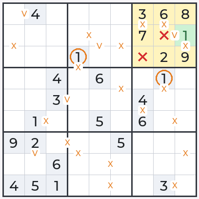

<!-- Written by tools/walkthrough.py xv: edit the script, not this page. -->
# XV, step 1: the 1 in box 3

**Step 1 of 57** · [← The start](../xv.md#the-whole-puzzle-step-by-step) · [All steps](../xv.md#the-whole-puzzle-step-by-step) · [Step 2 →](step-02.md)

Box 3 needs a 1. r2c8: column 8 has one (r4c8). r3c7: row 3 has one (r3c4). Only **r2c9** is left: **r2c9 = 1**.

**Step 1 of 57** · [← The start](../xv.md#the-whole-puzzle-step-by-step) · [All steps](../xv.md#the-whole-puzzle-step-by-step) · [Step 2 →](step-02.md)
