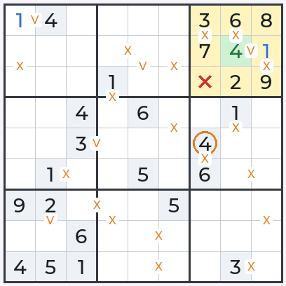

<!-- Written by tools/walkthrough.py xv: edit the script, not this page. -->
# XV, step 3: the 4 in box 3

**Step 3 of 57** · [← Step 2](step-02.md) · [All steps](../xv.md#the-whole-puzzle-step-by-step) · [Step 4 →](step-04.md)

Box 3 needs a 4. r3c7: column 7 has one (r5c7). Only **r2c8** is left: **r2c8 = 4**.

**Step 3 of 57** · [← Step 2](step-02.md) · [All steps](../xv.md#the-whole-puzzle-step-by-step) · [Step 4 →](step-04.md)
