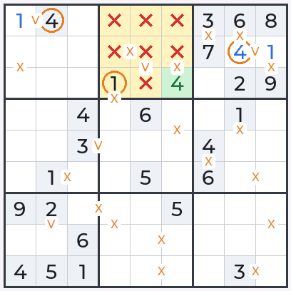

<!-- Written by tools/walkthrough.py xv: edit the script, not this page. -->
# XV, step 4: the 4 in box 2

**Step 4 of 57** · [← Step 3](step-03.md) · [All steps](../xv.md#the-whole-puzzle-step-by-step) · [Step 5 →](step-05.md)

Box 2 needs a 4. r1c4, r1c5 and r1c6: row 1 has one (r1c2). r2c4, r2c5 and r2c6: row 2 has one (r2c8). r3c5: there's no mark between it and the 1 in r3c4: it isn't 4 or 9. Only **r3c6** is left: **r3c6 = 4**.

**Step 4 of 57** · [← Step 3](step-03.md) · [All steps](../xv.md#the-whole-puzzle-step-by-step) · [Step 5 →](step-05.md)
