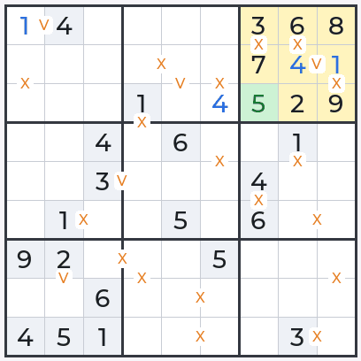

<!-- Written by tools/walkthrough.py xv: edit the script, not this page. -->
# XV, step 5: the 5 in box 3

**Step 5 of 57** · [← Step 4](step-04.md) · [All steps](../xv.md#the-whole-puzzle-step-by-step) · [Step 6 →](step-06.md)

Box 3 needs a 5, and r3c7 is its last empty cell: **r3c7 = 5**.

**Step 5 of 57** · [← Step 4](step-04.md) · [All steps](../xv.md#the-whole-puzzle-step-by-step) · [Step 6 →](step-06.md)
