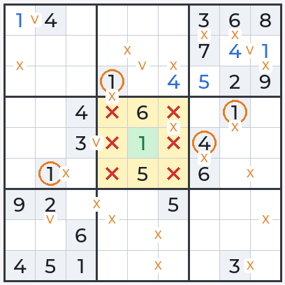

<!-- Written by tools/walkthrough.py xv: edit the script, not this page. -->
# XV, step 6: the 1 in box 5

**Step 6 of 57** · [← Step 5](step-05.md) · [All steps](../xv.md#the-whole-puzzle-step-by-step) · [Step 7 →](step-07.md)

Box 5 needs a 1. r4c4 and r4c6: row 4 has one (r4c8). r5c4: column 4 has one (r3c4). r6c4 and r6c6: row 6 has one (r6c2). r5c6: there's no mark between it and the 4 in r5c7: it isn't 1 or 6. Only **r5c5** is left: **r5c5 = 1**.

**Step 6 of 57** · [← Step 5](step-05.md) · [All steps](../xv.md#the-whole-puzzle-step-by-step) · [Step 7 →](step-07.md)
