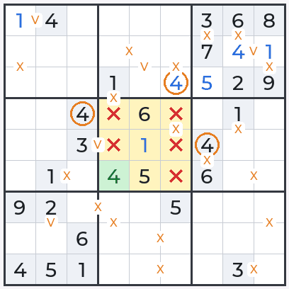

<!-- Written by tools/walkthrough.py xv: edit the script, not this page. -->
# XV, step 7: the 4 in box 5

**Step 7 of 57** · [← Step 6](step-06.md) · [All steps](../xv.md#the-whole-puzzle-step-by-step) · [Step 8 →](step-08.md)

Box 5 needs a 4. r4c4 and r4c6: row 4 has one (r4c3). r5c4 and r5c6: row 5 has one (r5c7). r6c6: column 6 has one (r3c6). Only **r6c4** is left: **r6c4 = 4**.

**Step 7 of 57** · [← Step 6](step-06.md) · [All steps](../xv.md#the-whole-puzzle-step-by-step) · [Step 8 →](step-08.md)
