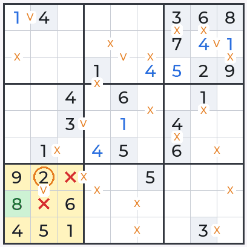

<!-- Written by tools/walkthrough.py xv: edit the script, not this page. -->
# XV, step 8: the 8 in box 7

**Step 8 of 57** · [← Step 7](step-07.md) · [All steps](../xv.md#the-whole-puzzle-step-by-step) · [Step 9 →](step-09.md)

Box 7 needs an 8. r7c3: there's no mark between it and the 2 in r7c2: it isn't 3 or 8. r8c2: a V joins it to the 2 in r7c2: it's 3. Only **r8c1** is left: **r8c1 = 8**.

**Step 8 of 57** · [← Step 7](step-07.md) · [All steps](../xv.md#the-whole-puzzle-step-by-step) · [Step 9 →](step-09.md)
