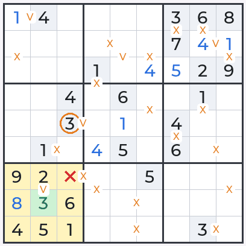

<!-- Written by tools/walkthrough.py xv: edit the script, not this page. -->
# XV, step 9: the 3 in box 7

**Step 9 of 57** · [← Step 8](step-08.md) · [All steps](../xv.md#the-whole-puzzle-step-by-step) · [Step 10 →](step-10.md)

Box 7 needs a 3. r7c3: column 3 has one (r5c3). Only **r8c2** is left: **r8c2 = 3**.

**Step 9 of 57** · [← Step 8](step-08.md) · [All steps](../xv.md#the-whole-puzzle-step-by-step) · [Step 10 →](step-10.md)
