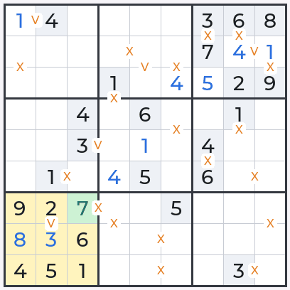

<!-- Written by tools/walkthrough.py xv: edit the script, not this page. -->
# XV, step 10: the 7 in box 7

**Step 10 of 57** · [← Step 9](step-09.md) · [All steps](../xv.md#the-whole-puzzle-step-by-step) · [Step 11 →](step-11.md)

Box 7 needs a 7, and r7c3 is its last empty cell: **r7c3 = 7**.

**Step 10 of 57** · [← Step 9](step-09.md) · [All steps](../xv.md#the-whole-puzzle-step-by-step) · [Step 11 →](step-11.md)
