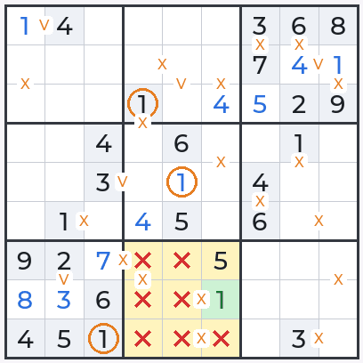

<!-- Written by tools/walkthrough.py xv: edit the script, not this page. -->
# XV, step 11: the 1 in box 8

**Step 11 of 57** · [← Step 10](step-10.md) · [All steps](../xv.md#the-whole-puzzle-step-by-step) · [Step 12 →](step-12.md)

Box 8 needs a 1. r7c4 and r8c4: column 4 has one (r3c4). r7c5 and r8c5: column 5 has one (r5c5). r9c4, r9c5 and r9c6: row 9 has one (r9c3). Only **r8c6** is left: **r8c6 = 1**.

**Step 11 of 57** · [← Step 10](step-10.md) · [All steps](../xv.md#the-whole-puzzle-step-by-step) · [Step 12 →](step-12.md)
