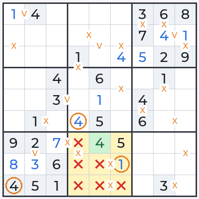

<!-- Written by tools/walkthrough.py xv: edit the script, not this page. -->
# XV, step 12: the 4 in box 8

**Step 12 of 57** · [← Step 11](step-11.md) · [All steps](../xv.md#the-whole-puzzle-step-by-step) · [Step 13 →](step-13.md)

Box 8 needs a 4. r7c4 and r8c4: column 4 has one (r6c4). r9c4, r9c5 and r9c6: row 9 has one (r9c1). r8c5: an X joins it to the 1 in r8c6: it's 9. Only **r7c5** is left: **r7c5 = 4**.

**Step 12 of 57** · [← Step 11](step-11.md) · [All steps](../xv.md#the-whole-puzzle-step-by-step) · [Step 13 →](step-13.md)
