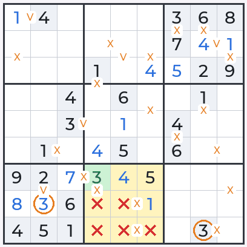

<!-- Written by tools/walkthrough.py xv: edit the script, not this page. -->
# XV, step 13: the 3 in box 8

**Step 13 of 57** · [← Step 12](step-12.md) · [All steps](../xv.md#the-whole-puzzle-step-by-step) · [Step 14 →](step-14.md)

Box 8 needs a 3. r8c4 and r8c5: row 8 has one (r8c2). r9c4, r9c5 and r9c6: row 9 has one (r9c8). Only **r7c4** is left: **r7c4 = 3**.

**Step 13 of 57** · [← Step 12](step-12.md) · [All steps](../xv.md#the-whole-puzzle-step-by-step) · [Step 14 →](step-14.md)
