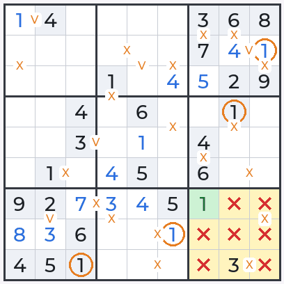

<!-- Written by tools/walkthrough.py xv: edit the script, not this page. -->
# XV, step 14: the 1 in box 9

**Step 14 of 57** · [← Step 13](step-13.md) · [All steps](../xv.md#the-whole-puzzle-step-by-step) · [Step 15 →](step-15.md)

Box 9 needs a 1. r7c8: column 8 has one (r4c8). r7c9: column 9 has one (r2c9). r8c7, r8c8 and r8c9: row 8 has one (r8c6). r9c7 and r9c9: row 9 has one (r9c3). Only **r7c7** is left: **r7c7 = 1**.

**Step 14 of 57** · [← Step 13](step-13.md) · [All steps](../xv.md#the-whole-puzzle-step-by-step) · [Step 15 →](step-15.md)
