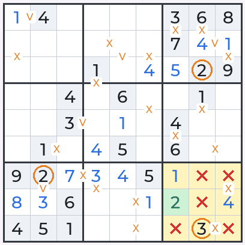

<!-- Written by tools/walkthrough.py xv: edit the script, not this page. -->
# XV, step 16: the 2 in box 9

**Step 16 of 57** · [← Step 15](step-15.md) · [All steps](../xv.md#the-whole-puzzle-step-by-step) · [Step 17 →](step-17.md)

Box 9 needs a 2. r7c8 and r7c9: row 7 has one (r7c2). r8c8: column 8 has one (r3c8). r9c7: there's no mark between it and the 3 in r9c8: it isn't 2 or 7. r9c9: an X joins it to the 3 in r9c8: it's 7. Only **r8c7** is left: **r8c7 = 2**.

**Step 16 of 57** · [← Step 15](step-15.md) · [All steps](../xv.md#the-whole-puzzle-step-by-step) · [Step 17 →](step-17.md)
