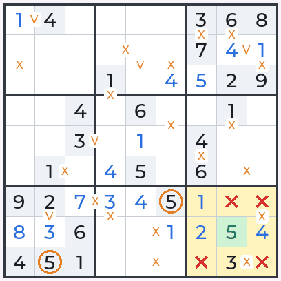

<!-- Written by tools/walkthrough.py xv: edit the script, not this page. -->
# XV, step 17: the 5 in box 9

**Step 17 of 57** · [← Step 16](step-16.md) · [All steps](../xv.md#the-whole-puzzle-step-by-step) · [Step 18 →](step-18.md)

Box 9 needs a 5. r7c8 and r7c9: row 7 has one (r7c6). r9c7 and r9c9: row 9 has one (r9c2). Only **r8c8** is left: **r8c8 = 5**.

**Step 17 of 57** · [← Step 16](step-16.md) · [All steps](../xv.md#the-whole-puzzle-step-by-step) · [Step 18 →](step-18.md)
