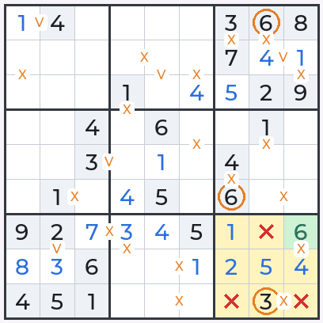

<!-- Written by tools/walkthrough.py xv: edit the script, not this page. -->
# XV, step 18: the 6 in box 9

**Step 18 of 57** · [← Step 17](step-17.md) · [All steps](../xv.md#the-whole-puzzle-step-by-step) · [Step 19 →](step-19.md)

Box 9 needs a 6. r7c8: column 8 has one (r1c8). r9c7: column 7 has one (r6c7). r9c9: an X joins it to the 3 in r9c8: it's 7. Only **r7c9** is left: **r7c9 = 6**.

**Step 18 of 57** · [← Step 17](step-17.md) · [All steps](../xv.md#the-whole-puzzle-step-by-step) · [Step 19 →](step-19.md)
