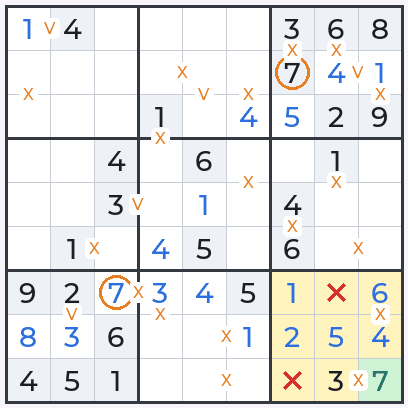

<!-- Written by tools/walkthrough.py xv: edit the script, not this page. -->
# XV, step 19: the 7 in box 9

**Step 19 of 57** · [← Step 18](step-18.md) · [All steps](../xv.md#the-whole-puzzle-step-by-step) · [Step 20 →](step-20.md)

Box 9 needs a 7. r7c8: row 7 has one (r7c3). r9c7: column 7 has one (r2c7). Only **r9c9** is left: **r9c9 = 7**.

**Step 19 of 57** · [← Step 18](step-18.md) · [All steps](../xv.md#the-whole-puzzle-step-by-step) · [Step 20 →](step-20.md)
