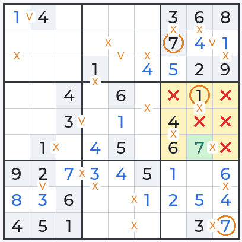

<!-- Written by tools/walkthrough.py xv: edit the script, not this page. -->
# XV, step 20: the 7 in box 6

**Step 20 of 57** · [← Step 19](step-19.md) · [All steps](../xv.md#the-whole-puzzle-step-by-step) · [Step 21 →](step-21.md)

Box 6 needs a 7. r4c7: column 7 has one (r2c7). r4c9, r5c9 and r6c9: column 9 has one (r9c9). r5c8: an X joins it to the 1 in r4c8: it's 9. Only **r6c8** is left: **r6c8 = 7**.

**Step 20 of 57** · [← Step 19](step-19.md) · [All steps](../xv.md#the-whole-puzzle-step-by-step) · [Step 21 →](step-21.md)
