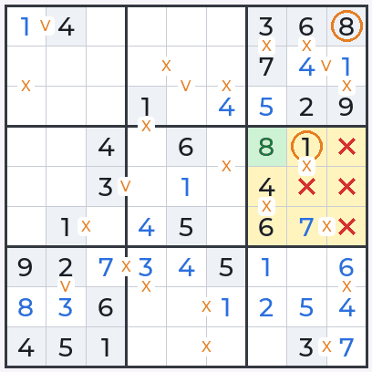

<!-- Written by tools/walkthrough.py xv: edit the script, not this page. -->
# XV, step 21: the 8 in box 6

**Step 21 of 57** · [← Step 20](step-20.md) · [All steps](../xv.md#the-whole-puzzle-step-by-step) · [Step 22 →](step-22.md)

Box 6 needs an 8. r4c9, r5c9 and r6c9: column 9 has one (r1c9). r5c8: an X joins it to the 1 in r4c8: it's 9. Only **r4c7** is left: **r4c7 = 8**.

**Step 21 of 57** · [← Step 20](step-20.md) · [All steps](../xv.md#the-whole-puzzle-step-by-step) · [Step 22 →](step-22.md)
