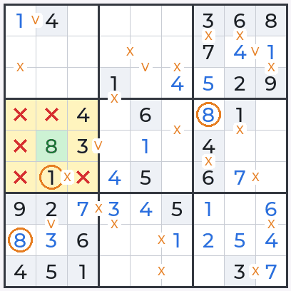

<!-- Written by tools/walkthrough.py xv: edit the script, not this page. -->
# XV, step 22: the 8 in box 4

**Step 22 of 57** · [← Step 21](step-21.md) · [All steps](../xv.md#the-whole-puzzle-step-by-step) · [Step 23 →](step-23.md)

Box 4 needs an 8. r4c1 and r4c2: row 4 has one (r4c7). r5c1 and r6c1: column 1 has one (r8c1). r6c3: an X joins it to the 1 in r6c2: it's 9. Only **r5c2** is left: **r5c2 = 8**.

**Step 22 of 57** · [← Step 21](step-21.md) · [All steps](../xv.md#the-whole-puzzle-step-by-step) · [Step 23 →](step-23.md)
