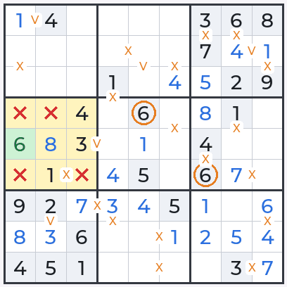

<!-- Written by tools/walkthrough.py xv: edit the script, not this page. -->
# XV, step 23: the 6 in box 4

**Step 23 of 57** · [← Step 22](step-22.md) · [All steps](../xv.md#the-whole-puzzle-step-by-step) · [Step 24 →](step-24.md)

Box 4 needs a 6. r4c1 and r4c2: row 4 has one (r4c5). r6c1 and r6c3: row 6 has one (r6c7). Only **r5c1** is left: **r5c1 = 6**.

**Step 23 of 57** · [← Step 22](step-22.md) · [All steps](../xv.md#the-whole-puzzle-step-by-step) · [Step 24 →](step-24.md)
