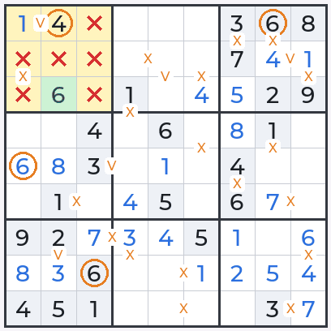

<!-- Written by tools/walkthrough.py xv: edit the script, not this page. -->
# XV, step 24: the 6 in box 1

**Step 24 of 57** · [← Step 23](step-23.md) · [All steps](../xv.md#the-whole-puzzle-step-by-step) · [Step 25 →](step-25.md)

Box 1 needs a 6. r1c3: row 1 has one (r1c8). r2c1 and r3c1: column 1 has one (r5c1). r2c3 and r3c3: column 3 has one (r8c3). r2c2: there's no mark between it and the 4 in r1c2: it isn't 1 or 6. Only **r3c2** is left: **r3c2 = 6**.

**Step 24 of 57** · [← Step 23](step-23.md) · [All steps](../xv.md#the-whole-puzzle-step-by-step) · [Step 25 →](step-25.md)
