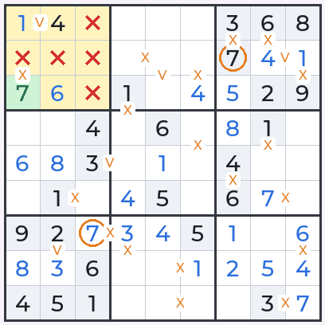

<!-- Written by tools/walkthrough.py xv: edit the script, not this page. -->
# XV, step 25: the 7 in box 1

**Step 25 of 57** · [← Step 24](step-24.md) · [All steps](../xv.md#the-whole-puzzle-step-by-step) · [Step 26 →](step-26.md)

Box 1 needs a 7. r1c3 and r3c3: column 3 has one (r7c3). r2c1, r2c2 and r2c3: row 2 has one (r2c7). Only **r3c1** is left: **r3c1 = 7**.

**Step 25 of 57** · [← Step 24](step-24.md) · [All steps](../xv.md#the-whole-puzzle-step-by-step) · [Step 26 →](step-26.md)
