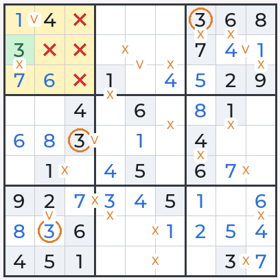

<!-- Written by tools/walkthrough.py xv: edit the script, not this page. -->
# XV, step 26: the 3 in box 1

**Step 26 of 57** · [← Step 25](step-25.md) · [All steps](../xv.md#the-whole-puzzle-step-by-step) · [Step 27 →](step-27.md)

Box 1 needs a 3. r1c3: row 1 has one (r1c7). r2c2: column 2 has one (r8c2). r2c3 and r3c3: column 3 has one (r5c3). Only **r2c1** is left: **r2c1 = 3**.

**Step 26 of 57** · [← Step 25](step-25.md) · [All steps](../xv.md#the-whole-puzzle-step-by-step) · [Step 27 →](step-27.md)
