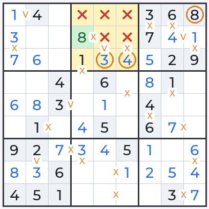

<!-- Written by tools/walkthrough.py xv: edit the script, not this page. -->
# XV, step 28: the 8 in box 2

**Step 28 of 57** · [← Step 27](step-27.md) · [All steps](../xv.md#the-whole-puzzle-step-by-step) · [Step 29 →](step-29.md)

Box 2 needs an 8. r1c4, r1c5 and r1c6: row 1 has one (r1c9). r2c5: a V joins it to the 3 in r3c5: it's 2. r2c6: an X joins it to the 4 in r3c6: it's 6. Only **r2c4** is left: **r2c4 = 8**.

**Step 28 of 57** · [← Step 27](step-27.md) · [All steps](../xv.md#the-whole-puzzle-step-by-step) · [Step 29 →](step-29.md)
