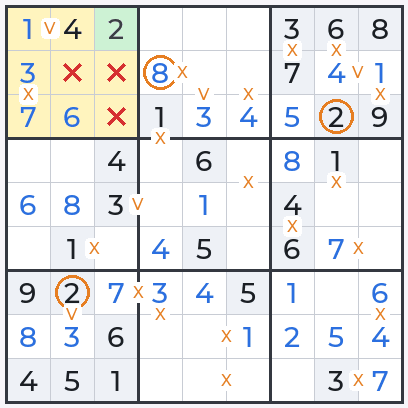

<!-- Written by tools/walkthrough.py xv: edit the script, not this page. -->
# XV, step 29: the 2 in box 1

**Step 29 of 57** · [← Step 28](step-28.md) · [All steps](../xv.md#the-whole-puzzle-step-by-step) · [Step 30 →](step-30.md)

Box 1 needs a 2. r2c2: column 2 has one (r7c2). r3c3: row 3 has one (r3c8). r2c3: there's no mark between it and the 8 in r2c4: it isn't 2. Only **r1c3** is left: **r1c3 = 2**.

**Step 29 of 57** · [← Step 28](step-28.md) · [All steps](../xv.md#the-whole-puzzle-step-by-step) · [Step 30 →](step-30.md)
