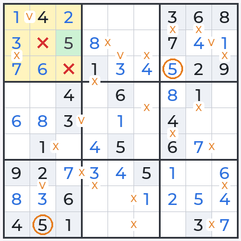

<!-- Written by tools/walkthrough.py xv: edit the script, not this page. -->
# XV, step 30: the 5 in box 1

**Step 30 of 57** · [← Step 29](step-29.md) · [All steps](../xv.md#the-whole-puzzle-step-by-step) · [Step 31 →](step-31.md)

Box 1 needs a 5. r2c2: column 2 has one (r9c2). r3c3: row 3 has one (r3c7). Only **r2c3** is left: **r2c3 = 5**.

**Step 30 of 57** · [← Step 29](step-29.md) · [All steps](../xv.md#the-whole-puzzle-step-by-step) · [Step 31 →](step-31.md)
