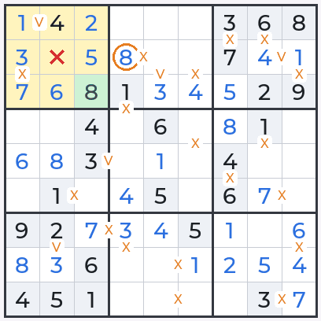

<!-- Written by tools/walkthrough.py xv: edit the script, not this page. -->
# XV, step 31: the 8 in box 1

**Step 31 of 57** · [← Step 30](step-30.md) · [All steps](../xv.md#the-whole-puzzle-step-by-step) · [Step 32 →](step-32.md)

Box 1 needs an 8. r2c2: row 2 has one (r2c4). Only **r3c3** is left: **r3c3 = 8**.

**Step 31 of 57** · [← Step 30](step-30.md) · [All steps](../xv.md#the-whole-puzzle-step-by-step) · [Step 32 →](step-32.md)
