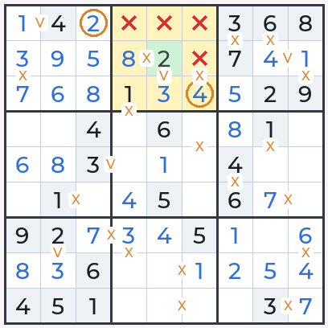

<!-- Written by tools/walkthrough.py xv: edit the script, not this page. -->
# XV, step 33: the 2 in box 2

**Step 33 of 57** · [← Step 32](step-32.md) · [All steps](../xv.md#the-whole-puzzle-step-by-step) · [Step 34 →](step-34.md)

Box 2 needs a 2. r1c4, r1c5 and r1c6: row 1 has one (r1c3). r2c6: an X joins it to the 4 in r3c6: it's 6. Only **r2c5** is left: **r2c5 = 2**.

**Step 33 of 57** · [← Step 32](step-32.md) · [All steps](../xv.md#the-whole-puzzle-step-by-step) · [Step 34 →](step-34.md)
