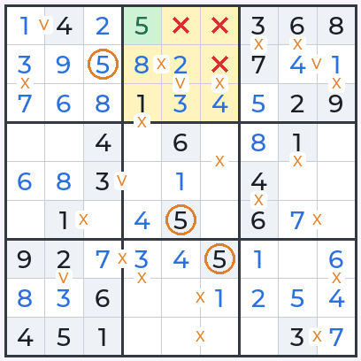

<!-- Written by tools/walkthrough.py xv: edit the script, not this page. -->
# XV, step 34: the 5 in box 2

**Step 34 of 57** · [← Step 33](step-33.md) · [All steps](../xv.md#the-whole-puzzle-step-by-step) · [Step 35 →](step-35.md)

Box 2 needs a 5. r1c5: column 5 has one (r6c5). r1c6: column 6 has one (r7c6). r2c6: row 2 has one (r2c3). Only **r1c4** is left: **r1c4 = 5**.

**Step 34 of 57** · [← Step 33](step-33.md) · [All steps](../xv.md#the-whole-puzzle-step-by-step) · [Step 35 →](step-35.md)
