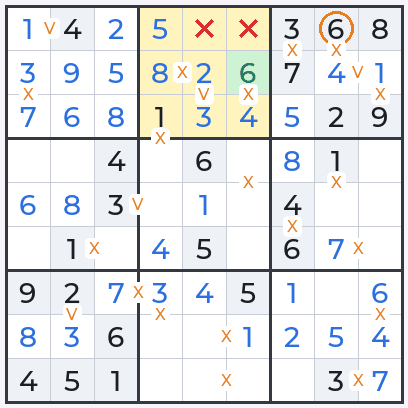

<!-- Written by tools/walkthrough.py xv: edit the script, not this page. -->
# XV, step 35: the 6 in box 2

**Step 35 of 57** · [← Step 34](step-34.md) · [All steps](../xv.md#the-whole-puzzle-step-by-step) · [Step 36 →](step-36.md)

Box 2 needs a 6. r1c5 and r1c6: row 1 has one (r1c8). Only **r2c6** is left: **r2c6 = 6**.

**Step 35 of 57** · [← Step 34](step-34.md) · [All steps](../xv.md#the-whole-puzzle-step-by-step) · [Step 36 →](step-36.md)
