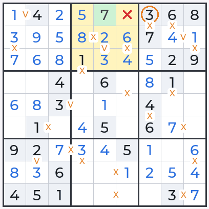

<!-- Written by tools/walkthrough.py xv: edit the script, not this page. -->
# XV, step 36: the 7 in box 2

**Step 36 of 57** · [← Step 35](step-35.md) · [All steps](../xv.md#the-whole-puzzle-step-by-step) · [Step 37 →](step-37.md)

Box 2 needs a 7. r1c6: there's no mark between it and the 3 in r1c7: it isn't 2 or 7. Only **r1c5** is left: **r1c5 = 7**.

**Step 36 of 57** · [← Step 35](step-35.md) · [All steps](../xv.md#the-whole-puzzle-step-by-step) · [Step 37 →](step-37.md)
