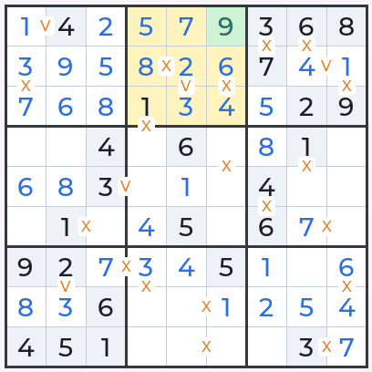

<!-- Written by tools/walkthrough.py xv: edit the script, not this page. -->
# XV, step 37: the 9 in box 2

**Step 37 of 57** · [← Step 36](step-36.md) · [All steps](../xv.md#the-whole-puzzle-step-by-step) · [Step 38 →](step-38.md)

Box 2 needs a 9, and r1c6 is its last empty cell: **r1c6 = 9**.

**Step 37 of 57** · [← Step 36](step-36.md) · [All steps](../xv.md#the-whole-puzzle-step-by-step) · [Step 38 →](step-38.md)
