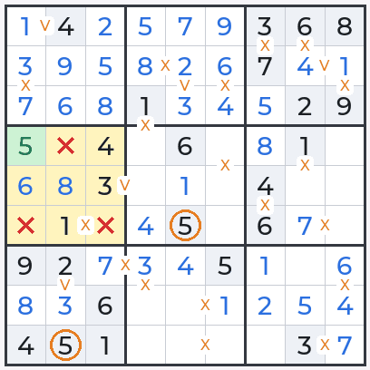

<!-- Written by tools/walkthrough.py xv: edit the script, not this page. -->
# XV, step 38: the 5 in box 4

**Step 38 of 57** · [← Step 37](step-37.md) · [All steps](../xv.md#the-whole-puzzle-step-by-step) · [Step 39 →](step-39.md)

Box 4 needs a 5. r4c2: column 2 has one (r9c2). r6c1 and r6c3: row 6 has one (r6c5). Only **r4c1** is left: **r4c1 = 5**.

**Step 38 of 57** · [← Step 37](step-37.md) · [All steps](../xv.md#the-whole-puzzle-step-by-step) · [Step 39 →](step-39.md)
