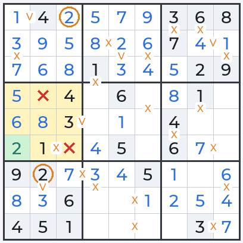

<!-- Written by tools/walkthrough.py xv: edit the script, not this page. -->
# XV, step 39: the 2 in box 4

**Step 39 of 57** · [← Step 38](step-38.md) · [All steps](../xv.md#the-whole-puzzle-step-by-step) · [Step 40 →](step-40.md)

Box 4 needs a 2. r4c2: column 2 has one (r7c2). r6c3: column 3 has one (r1c3). Only **r6c1** is left: **r6c1 = 2**.

**Step 39 of 57** · [← Step 38](step-38.md) · [All steps](../xv.md#the-whole-puzzle-step-by-step) · [Step 40 →](step-40.md)
