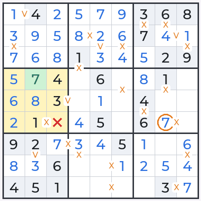

<!-- Written by tools/walkthrough.py xv: edit the script, not this page. -->
# XV, step 40: the 7 in box 4

**Step 40 of 57** · [← Step 39](step-39.md) · [All steps](../xv.md#the-whole-puzzle-step-by-step) · [Step 41 →](step-41.md)

Box 4 needs a 7. r6c3: row 6 has one (r6c8). Only **r4c2** is left: **r4c2 = 7**.

**Step 40 of 57** · [← Step 39](step-39.md) · [All steps](../xv.md#the-whole-puzzle-step-by-step) · [Step 41 →](step-41.md)
