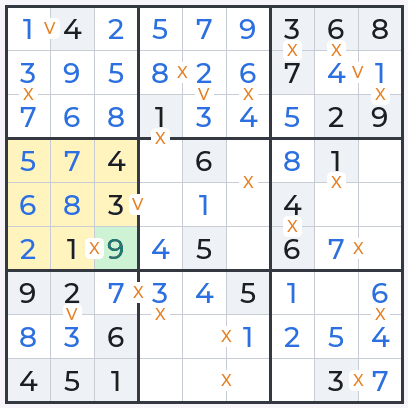

<!-- Written by tools/walkthrough.py xv: edit the script, not this page. -->
# XV, step 41: the 9 in box 4

**Step 41 of 57** · [← Step 40](step-40.md) · [All steps](../xv.md#the-whole-puzzle-step-by-step) · [Step 42 →](step-42.md)

Box 4 needs a 9, and r6c3 is its last empty cell: **r6c3 = 9**.

**Step 41 of 57** · [← Step 40](step-40.md) · [All steps](../xv.md#the-whole-puzzle-step-by-step) · [Step 42 →](step-42.md)
