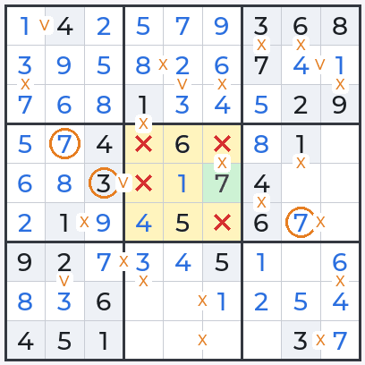

<!-- Written by tools/walkthrough.py xv: edit the script, not this page. -->
# XV, step 42: the 7 in box 5

**Step 42 of 57** · [← Step 41](step-41.md) · [All steps](../xv.md#the-whole-puzzle-step-by-step) · [Step 43 →](step-43.md)

Box 5 needs a 7. r4c4 and r4c6: row 4 has one (r4c2). r6c6: row 6 has one (r6c8). r5c4: a V joins it to the 3 in r5c3: it's 2. Only **r5c6** is left: **r5c6 = 7**.

**Step 42 of 57** · [← Step 41](step-41.md) · [All steps](../xv.md#the-whole-puzzle-step-by-step) · [Step 43 →](step-43.md)
