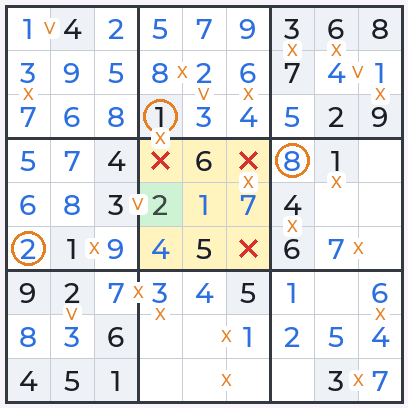

<!-- Written by tools/walkthrough.py xv: edit the script, not this page. -->
# XV, step 43: the 2 in box 5

**Step 43 of 57** · [← Step 42](step-42.md) · [All steps](../xv.md#the-whole-puzzle-step-by-step) · [Step 44 →](step-44.md)

Box 5 needs a 2. r6c6: row 6 has one (r6c1). r4c4: an X joins it to the 1 in r3c4: it's 9. r4c6: there's no mark between it and the 8 in r4c7: it isn't 2. Only **r5c4** is left: **r5c4 = 2**.

**Step 43 of 57** · [← Step 42](step-42.md) · [All steps](../xv.md#the-whole-puzzle-step-by-step) · [Step 44 →](step-44.md)
