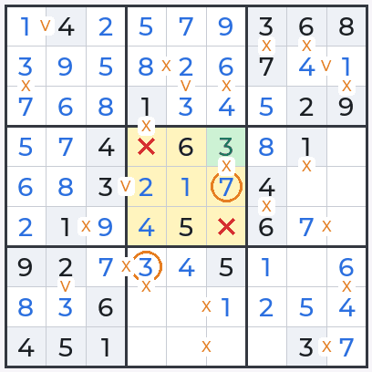

<!-- Written by tools/walkthrough.py xv: edit the script, not this page. -->
# XV, step 44: the 3 in box 5

**Step 44 of 57** · [← Step 43](step-43.md) · [All steps](../xv.md#the-whole-puzzle-step-by-step) · [Step 45 →](step-45.md)

Box 5 needs a 3. r4c4: column 4 has one (r7c4). r6c6: there's no mark between it and the 7 in r5c6: it isn't 3. Only **r4c6** is left: **r4c6 = 3**.

**Step 44 of 57** · [← Step 43](step-43.md) · [All steps](../xv.md#the-whole-puzzle-step-by-step) · [Step 45 →](step-45.md)
