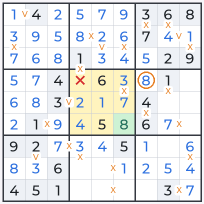

<!-- Written by tools/walkthrough.py xv: edit the script, not this page. -->
# XV, step 45: the 8 in box 5

**Step 45 of 57** · [← Step 44](step-44.md) · [All steps](../xv.md#the-whole-puzzle-step-by-step) · [Step 46 →](step-46.md)

Box 5 needs an 8. r4c4: row 4 has one (r4c7). Only **r6c6** is left: **r6c6 = 8**.

**Step 45 of 57** · [← Step 44](step-44.md) · [All steps](../xv.md#the-whole-puzzle-step-by-step) · [Step 46 →](step-46.md)
