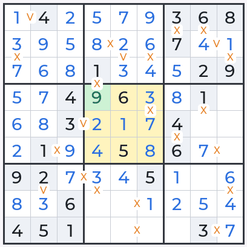

<!-- Written by tools/walkthrough.py xv: edit the script, not this page. -->
# XV, step 46: the 9 in box 5

**Step 46 of 57** · [← Step 45](step-45.md) · [All steps](../xv.md#the-whole-puzzle-step-by-step) · [Step 47 →](step-47.md)

Box 5 needs a 9, and r4c4 is its last empty cell: **r4c4 = 9**.

**Step 46 of 57** · [← Step 45](step-45.md) · [All steps](../xv.md#the-whole-puzzle-step-by-step) · [Step 47 →](step-47.md)
