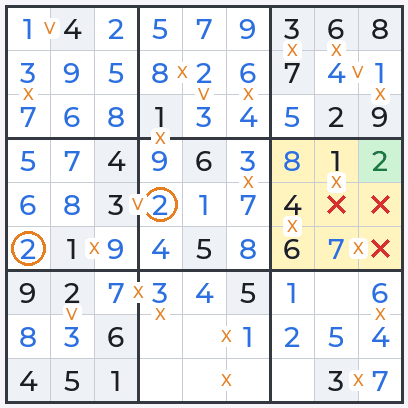

<!-- Written by tools/walkthrough.py xv: edit the script, not this page. -->
# XV, step 47: the 2 in box 6

**Step 47 of 57** · [← Step 46](step-46.md) · [All steps](../xv.md#the-whole-puzzle-step-by-step) · [Step 48 →](step-48.md)

Box 6 needs a 2. r5c8 and r5c9: row 5 has one (r5c4). r6c9: row 6 has one (r6c1). Only **r4c9** is left: **r4c9 = 2**.

**Step 47 of 57** · [← Step 46](step-46.md) · [All steps](../xv.md#the-whole-puzzle-step-by-step) · [Step 48 →](step-48.md)
