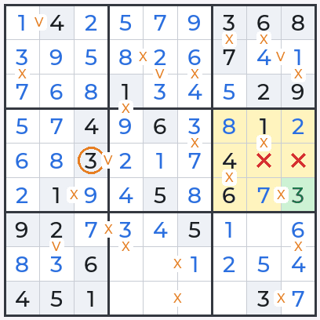

<!-- Written by tools/walkthrough.py xv: edit the script, not this page. -->
# XV, step 48: the 3 in box 6

**Step 48 of 57** · [← Step 47](step-47.md) · [All steps](../xv.md#the-whole-puzzle-step-by-step) · [Step 49 →](step-49.md)

Box 6 needs a 3. r5c8 and r5c9: row 5 has one (r5c3). Only **r6c9** is left: **r6c9 = 3**.

**Step 48 of 57** · [← Step 47](step-47.md) · [All steps](../xv.md#the-whole-puzzle-step-by-step) · [Step 49 →](step-49.md)
